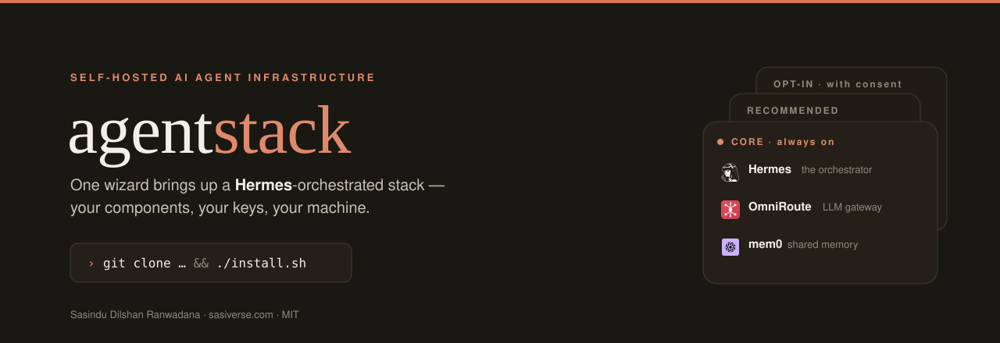
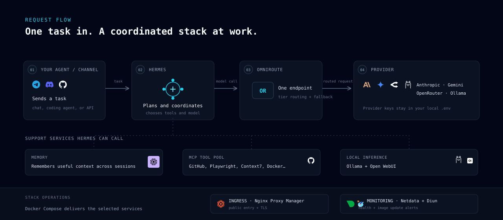

<div align="center">



<br/>

[](https://github.com/sasindudilshanranwadana/agentstack/actions/workflows/ci.yml)
[](LICENSE)
[](#requirements)
[](#requirements)
[](#requirements)

<br/>

[](https://ko-fi.com/sasiverse)

</div>

---

## What is agentstack

Self-hosting a capable AI agent usually means stitching together disconnected
services, API keys, containers, and config by hand — and getting those pieces to
cooperate often takes more effort than using the agent itself.

agentstack folds that into **one repo and one wizard**. Pick the components you
want, bring your **own** keys, and get a running Docker Compose stack with
**Hermes orchestrating** the work — an LLM gateway ([OmniRoute](CREDITS.md)),
shared memory ([mem0](CREDITS.md)), an MCP tool pool, local inference, ingress,
and monitoring. Runs on **Linux, macOS, and Windows** (Docker required); your
keys live only in a local, git-ignored `.env`.

> agentstack is **orchestration glue**. Every bundled tool is the work of its
> original authors — see [CREDITS.md](CREDITS.md) and
> [THIRD_PARTY_NOTICES.md](THIRD_PARTY_NOTICES.md). This is not an official
> distribution of any of them.

## Install

The only prerequisite is **Docker** (Desktop on macOS/Windows, Engine on Linux).
Both paths below drop you into the same wizard.

### Option A — native installer (no Git, no Python)

Grab the build for your OS from the
[**Releases**](https://github.com/sasindudilshanranwadana/agentstack/releases)
page and run it. It bundles its own Python, checks Docker, downloads agentstack,
runs the wizard, and offers to bring the stack up.

| OS | File | How to run |
|----|------|------------|
| **Windows** | `agentstack-setup-windows-x86_64.exe` | double-click (on SmartScreen → *More info → Run anyway*) |
| **macOS** | `agentstack-setup-macos.dmg` | open the `.dmg`, then right-click → *Open* (unsigned build) |
| **Linux** | `agentstack-setup-linux-x86_64.tar.gz` | `tar xzf *.tar.gz && ./agentstack-setup` |

### Option B — from source (Git)

```bash
git clone https://github.com/sasindudilshanranwadana/agentstack
cd agentstack
./install.sh          # Linux / macOS
#  .\install.ps1      # Windows (PowerShell)
```

Either way, the wizard walks you through: **pick components → consent for
anything privileged → choose integrations → enter your keys** (written only to a
local, git-ignored `.env`) → it brings up exactly what you selected.

## How it works

One task in, and the stack coordinates around it — your agent or channel hands
Hermes a task, Hermes plans it and calls the model through OmniRoute, and the
support services kick in as needed:

<div align="center">

</div>

You send a task from a channel or coding agent. Hermes receives it, decides which
model and tools fit the request, and coordinates the steps. For model calls it
uses **OmniRoute** — a single gateway that routes across supported providers,
stacks available free tiers, and falls back when a route is unavailable. You
bring the provider keys, and they stay in your local `.env`.

While working, Hermes can use **mem0** to carry memory between sessions and an
**MCP tool pool** to reach services such as GitHub, Playwright, Context7, Docker,
or Postgres. **Local inference** is optional — Ollama serves local models, with
Open WebUI to manage them. **Nginx Proxy Manager** provides public ingress and
TLS; **Netdata + Diun** handle monitoring and image-update alerts. The wizard
lets you choose which pieces you want, and Docker Compose runs them together.

## Why agentstack (and the trade-offs)

| Strengths | Trade-offs |
| --- | --- |
| You own the deployment and its data. | Docker is required, and you run, secure, and pay for the infrastructure yourself. |
| OmniRoute makes the model layer provider-agnostic, with tier routing and fallback. | Provider access and free tiers depend on the providers; you supply and manage the keys. |
| A modular wizard lets you select only the services you need. | More components mean more configuration, updates, and operational responsibility. |
| mem0 shares memory across sessions; MCP opens a broad tool ecosystem. | The tools you connect have their own permissions and security implications. |
| Runs wherever Docker runs — self-hosted machines and servers alike. | Local inference benefits from a capable machine, especially for larger models. |
| Open components and an adaptable stack. | This is orchestration glue, not a managed product; upstream licenses vary. |

> **Security note:** `host-gateway` is an opt-in path to privileged host access.
> It is powerful and is **not** a sandbox — only enable it for agents and tools
> you trust as much as yourself.

## Architecture

Hermes sits at the hub; everything else is a ring you opt into — all on one
private Docker network, with your keys living only in `.env`:

<div align="center">

</div>

## Components

| Tier | Component | What it is |
|------|-----------|------------|
| **Core** (always) | `hermes` | The orchestrator — the boss |
| | `omniroute` | LLM gateway, one endpoint for any provider |
| | `mem0` | Shared memory across sessions |
| **Recommended** | `headroom` | Context compression (cheaper long sessions) |
| | `mcp` | Tool pool (GitHub, Playwright, …) |
| | `inference` | Local models (Ollama + Open WebUI) |
| | `ingress` | Public entry + TLS (Nginx Proxy Manager) |
| | `monitoring` | Netdata + Diun |
| **Opt-in** ⚠ | `host-gateway` | Privileged, token-gated host access (Linux only) |
| | `hexstrike` | Security tooling (authorized use only) |

Opt-in components are **off by default** and require typed confirmation. Read
their blast radius first — `host-gateway` in particular is a trusted-agent power
tool, **not** a sandbox (see its [README](stacks/optin/host-gateway/README.md)).

## Swappable integrations

Chosen in the wizard, not hardcoded:

- **Notifications:** Telegram · Discord · Slack · Email · none
- **LLM providers:** OpenAI · Anthropic · Google · OpenRouter · local (multi-select)
- **Ingress:** domain + Let's Encrypt TLS · localhost only

## Requirements

- Docker Engine (Linux) or Docker Desktop (macOS/Windows) with **Compose v2**
- **Python 3.10+**

## Secrets & safety

Your keys live **only** in a git-ignored `.env`. Nothing secret or personal is
committed, and a repo-wide publish-safety scan plus gitleaks run in CI. See
[SECURITY.md](SECURITY.md).

## Support

If agentstack saves you time, you can support the work — it genuinely helps.

<div align="center">

[](https://ko-fi.com/sasiverse)

</div>

## License

MIT © 2026 **Sasindu Dilshan Ranwadana** ([@sasiverse](https://x.com/sasiverse) ·
[sasiverse.com](https://sasiverse.com)). See [LICENSE](LICENSE),
[CREDITS.md](CREDITS.md), and [CONTRIBUTING.md](CONTRIBUTING.md).
