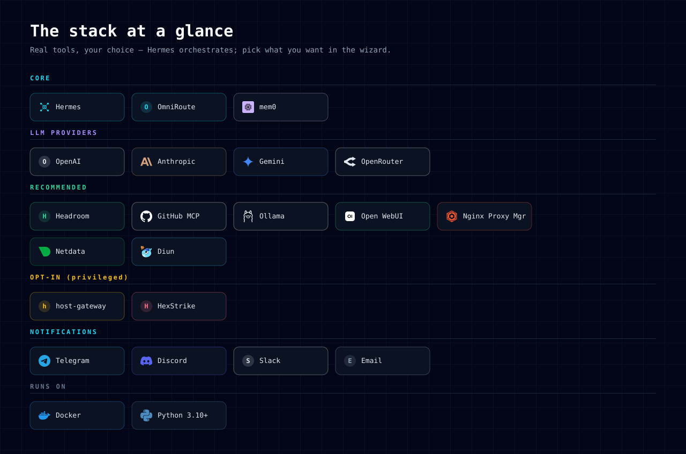
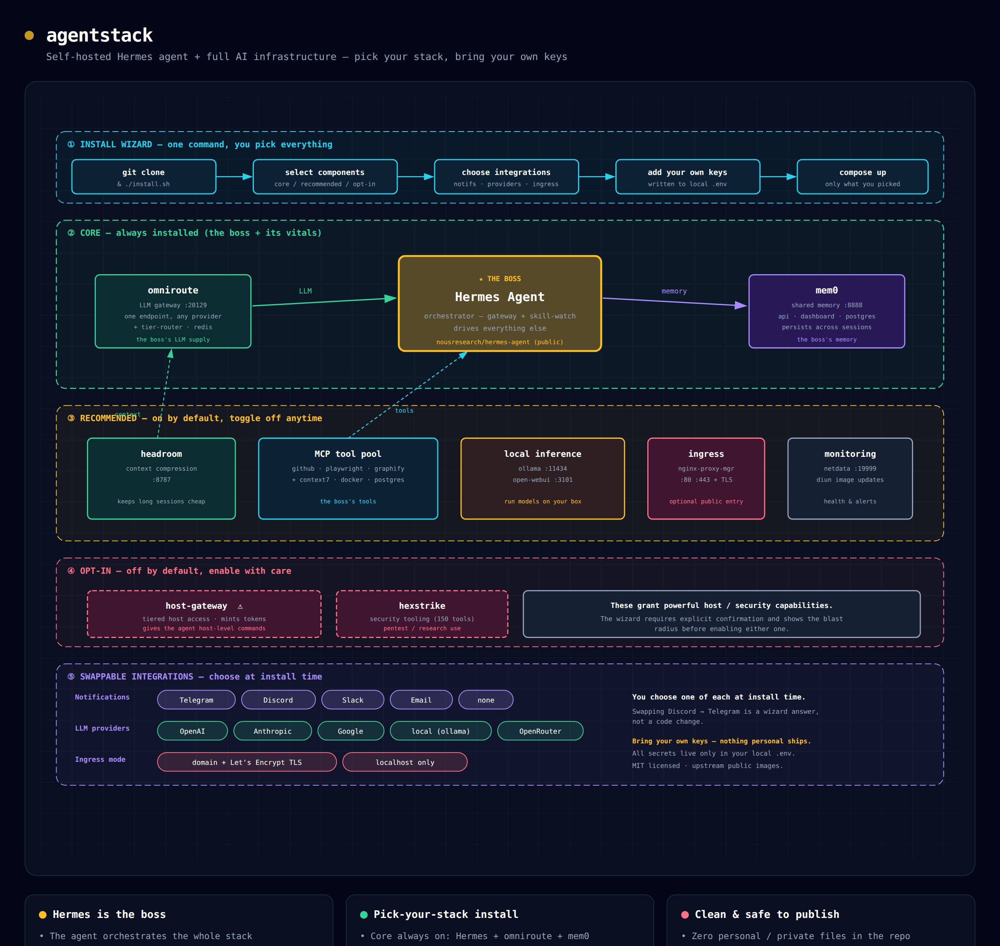

<div align="center">


<br/>

[](https://github.com/sasindudilshanranwadana/agentstack/actions/workflows/ci.yml)
[](LICENSE)
[](#requirements)
[](#requirements)
[](#requirements)

### Self-hostable AI agent infrastructure — Hermes at the core, your stack, your keys.

<br/>


<br/>

[](https://ko-fi.com/sasiverse)

</div>

---

One repo, one wizard. Choose the components you want, wire in **your own** API
keys, and get a running stack with **Hermes as the orchestrator** — backed by an
LLM gateway ([OmniRoute](CREDITS.md)), shared memory ([mem0](CREDITS.md)), a tool
pool (MCP), local inference, and monitoring. Runs on **Linux, macOS, and
Windows** (Docker required).

> agentstack is **orchestration glue**. Every bundled tool is the work of its
> original authors — see [CREDITS.md](CREDITS.md) and
> [THIRD_PARTY_NOTICES.md](THIRD_PARTY_NOTICES.md). This is not an official
> distribution of any of them.

## Quick start

```bash
git clone https://github.com/sasindudilshanranwadana/agentstack
cd agentstack
./install.sh          # Linux / macOS
#  .\install.ps1      # Windows (PowerShell)
```

The wizard walks you through: **pick components → consent for anything
privileged → choose integrations → enter your keys** (written only to a local,
git-ignored `.env`) → it brings up exactly what you selected.

## The stack at a glance

Real tools, your choice — Hermes orchestrates, and you pick what you want in the
wizard. These are the real brand marks wherever one exists. **OpenAI** and
**Slack** use a monogram (their marks are trademark-restricted), and **Hermes**,
**OmniRoute**, **Headroom** and **host-gateway** have no official logo — Hermes
carries a purpose-drawn orchestrator emblem.

<div align="center">

</div>

## Architecture

How it fits together — providers flow into OmniRoute, Hermes orchestrates, mem0
remembers, and your selected tools hang off the shared network:

<div align="center">

</div>

## Components

| Tier | Component | What it is |
|------|-----------|------------|
| **Core** (always) | `hermes` | The orchestrator — the boss |
| | `omniroute` | LLM gateway, one endpoint for any provider |
| | `mem0` | Shared memory across sessions |
| **Recommended** | `headroom` | Context compression (cheaper long sessions) |
| | `mcp` | Tool pool (GitHub, Playwright, …) |
| | `inference` | Local models (Ollama + Open WebUI) |
| | `ingress` | Public entry + TLS (Nginx Proxy Manager) |
| | `monitoring` | Netdata + Diun |
| **Opt-in** ⚠ | `host-gateway` | Privileged, token-gated host access (Linux only) |
| | `hexstrike` | Security tooling (authorized use only) |

Opt-in components are **off by default** and require typed confirmation. Read
their blast radius first — `host-gateway` in particular is a trusted-agent power
tool, **not** a sandbox (see its [README](stacks/optin/host-gateway/README.md)).

## Swappable integrations

Chosen in the wizard, not hardcoded:

- **Notifications:** Telegram · Discord · Slack · Email · none
- **LLM providers:** OpenAI · Anthropic · Google · OpenRouter · local (multi-select)
- **Ingress:** domain + Let's Encrypt TLS · localhost only

## Requirements

- Docker Engine (Linux) or Docker Desktop (macOS/Windows) with **Compose v2**
- **Python 3.10+**

## Secrets & safety

Your keys live **only** in a git-ignored `.env`. Nothing secret or personal is
committed, and a repo-wide publish-safety scan plus gitleaks run in CI. See
[SECURITY.md](SECURITY.md).

## Support

If agentstack saves you time, you can support the work — it genuinely helps.

<div align="center">

[](https://ko-fi.com/sasiverse)

</div>

## License

MIT © 2026 **Sasindu Dilshan Ranwadana** ([@sasiverse](https://x.com/sasiverse) ·
[sasiverse.com](https://sasiverse.com)). See [LICENSE](LICENSE),
[CREDITS.md](CREDITS.md), and [CONTRIBUTING.md](CONTRIBUTING.md).
